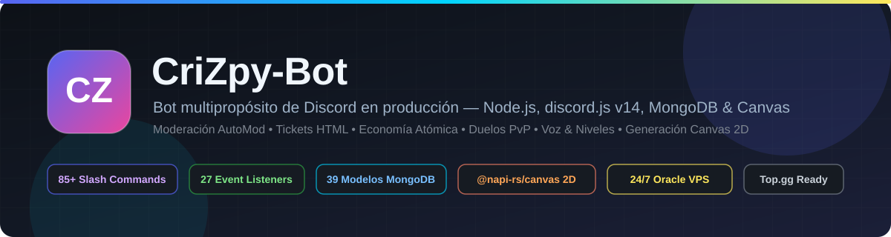
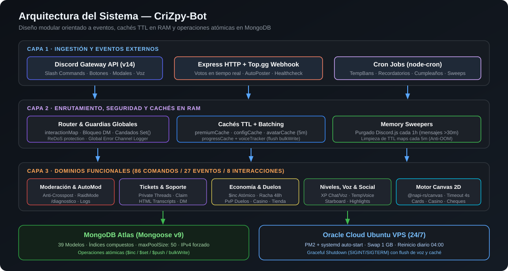
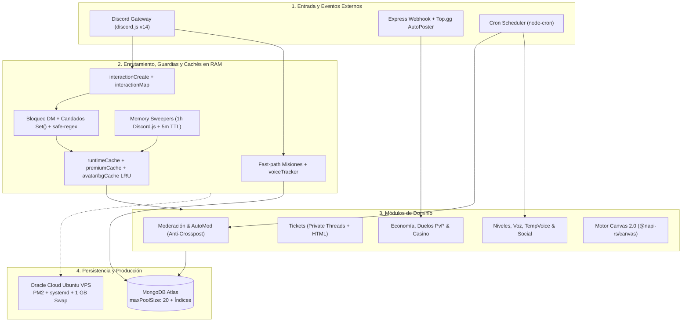
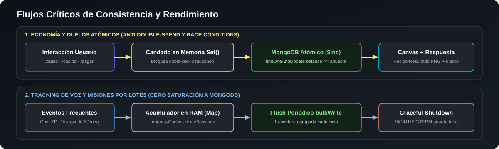
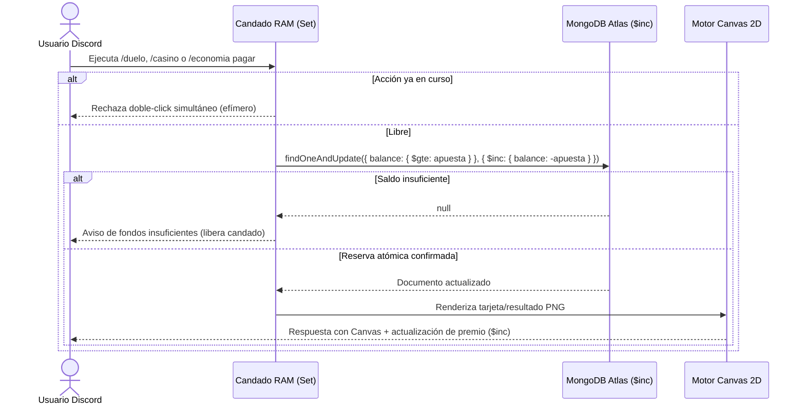
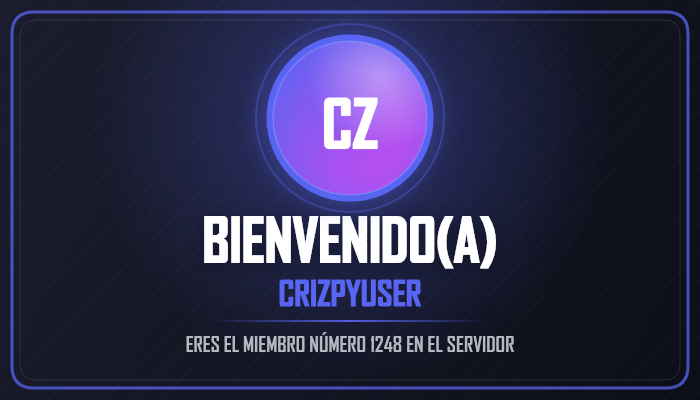
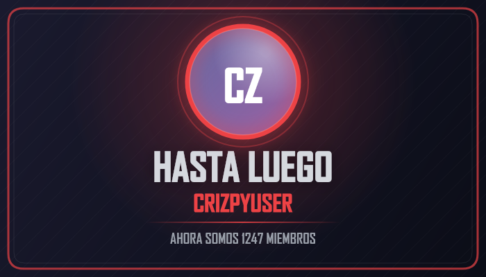
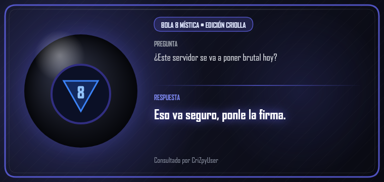

<div align="center">



<p>
  <a href="https://discord.com/oauth2/authorize?client_id=1521995464029769808">
    
  </a>
  <a href="https://discord.com/application-directory/1521995464029769808">
    
  </a>
  <a href="https://top.gg/bot/1521995464029769808">
    
  </a>
  <a href="https://discord.gg/qZMkwc89af">
    
  </a>
</p>

<p>
  
  
  
  
  
</p>

</div>

> [!NOTE]
> Este repositorio es un **showcase público de arquitectura y producto**. El código fuente de **CriZpy-Bot** se mantiene en repositorio privado.

---

## Resumen

**CriZpy-Bot** es un bot multipropósito para comunidades de Discord en español, desarrollado en **Node.js** con **discord.js v14**, **MongoDB (Mongoose)** y **@napi-rs/canvas**. Centraliza moderación automatizada, sistema de tickets en hilos privados, economía atómica con duelos PvP, niveles por texto/voz y generación dinámica de tarjetas gráficas 2D, operando 24/7 en **Oracle Cloud (Ubuntu VPS + PM2)**.

| Métrica del Proyecto | Alcance |
| --- | --- |
| **Comandos Slash & Context** | **86** Slash Commands + **4** Context Menus (**90** comandos globales registrados) |
| **Eventos de Discord** | **27** listeners reactivos (`messageCreate`, `voiceStateUpdate`, `guildMemberAdd`, etc.) |
| **Interacciones Globales** | **11** manejadores persistentes (botones, select menus, modales, tickets DM) |
| **Modelos de Datos** | **39** esquemas Mongoose con índices compuestos y colecciones TTL |
| **Utilidades Core** | **32** módulos especializados (Canvas 2.0, `runtimeCache`, caché LRU de imágenes, voz, AutoMod, permisos) |
| **Suite de Tests** | **51** pruebas unitarias nativas con `node:test` (11 suites) |

---

## Enlaces del Bot

- **Invitar a tu servidor:** [Agregar CriZpy-Bot a Discord](https://discord.com/oauth2/authorize?client_id=1521995464029769808)
- **Directorio oficial:** [Discord Application Directory](https://discord.com/application-directory/1521995464029769808)
- **Top.gg:** [Ficha del Bot](https://top.gg/bot/1521995464029769808) · [Votar cada 12h](https://top.gg/bot/1521995464029769808/vote)
- **Comunidad y soporte:** [Servidor oficial de Discord](https://discord.gg/qZMkwc89af)

---

## Arquitectura del Sistema



### Diagrama de Componentes (Mermaid)



### Organización Modular

```text
crizpy-bot/
├── index.js                 # Arranque, Express/Top.gg, Mongoose, Sweepers y graceful shutdown
├── deploy-commands.js       # Registro global de Slash Commands y Context Menus
├── deploy-guild.js          # Registro rápido en servidor de pruebas
├── scripts/                 # Healthcheck y respaldo automatizado de MongoDB
├── src/
│   ├── commands/            # 86 Slash Commands organizados por dominio
│   ├── contextMenus/        # 4 Context Menus nativos de Discord
│   ├── events/              # 27 listeners del Gateway de Discord
│   ├── interactions/        # 11 manejadores globales (tickets, ayuda, tienda, embeds, roles, DM)
│   ├── models/              # 39 esquemas e índices compuestos en Mongoose
│   └── utils/               # 32 utilidades (Canvas 2.0, runtimeCache, LRU, voz, AutoMod, permisos)
└── test/                    # 51 pruebas unitarias (11 suites) con node:test
```

---

## Flujos Críticos de Consistencia y Rendimiento



### Secuencia Anti-Race Condition (Economía, Duelos y Casino)



---

## Capturas del Motor Gráfico (`@napi-rs/canvas`)

Las siguientes imágenes fueron renderizadas con los generadores reales de `CriZpy-Bot` (`canvasWelcomeCard.js`, `canvasFarewellCard.js`, `canvasVoteCrate.js` y `canvasCardsExtra.js`), usando la **configuración por defecto** del bot y un avatar de muestra (en producción se usa el avatar real del usuario):

| Tarjeta de Bienvenida (`/bienvenida canvas`) | Tarjeta de Despedida (`/despedida canvas`) |
| :---: | :---: |
|  |  |
| **Avatar circular, textos y aro configurables** | **Fondo degradado, avatar en escala de grises y glow** |

| Recompensa por Voto (`/votar` + `/caja abrir`) | Bola 8 Mística (`/bola8`) |
| :---: | :---: |
|  |  |
| **Gradiente radial, rareza dinámica y auto-escalado tipográfico** | **Esfera 3D, ventana neón y respuesta con wrapping automático** |

Además de estos generadores, el bot produce en vivo tarjetas Canvas 2.0 para `/info` (3 pestañas interactivas), `/perfil`, `/rank`, `/economia` (`balance`, `trabajar`, `pagar`, `tienda`), `/crimen`, `/robar`, `/duelo`, `/casarse`, `/matrimonio`, `/ship`, `/confesar`, `/recordatorio`, `/misiones`, `/reputacion`, `/sorteo` (ganador VIP), `/cumpleaños`, `/top` y `/casino` (Blackjack, Ruleta, Tragamonedas, Moneda).

---

## Módulos y Capacidades

| Dominio | Funcionalidades Destacadas |
| --- | --- |
| **Moderación & AutoMod** | `ban`, `softban`, `kick`, `timeout`, `warn`, `purge`, `autopurge`, `lock`, `slowmode`, `raidmode`, `modlog` y `serverlogs`. Detector **Anti-Crosspost** contra cuentas comprometidas (`>=3` canales en `<15s`), filtros con `safe-regex` anti-ReDoS y escáner `/diagnostico` de permisos. |
| **Tickets en Hilos Privados** | Paneles configurables (`/ticket panel`) que abren **Private Threads** en el canal, soporte por **DM directo** al bot (`Ticket-MD`), sistema de reclamo (`claim`) y exportación automática de transcripciones HTML (`discord-html-transcripts`). |
| **Economía, Casino & Duelos** | Cartera, racha diaria con ventana de `48h` y Cajas Sorpresa cada 7 días, tienda con roles, `/duelo` PvP 1v1 por turnos con botones, misiones diarias RPG y `/casino` (Blackjack, Ruleta, Tragamonedas, Moneda). |
| **Niveles, Voz & TempVoice** | XP por chat con alertas configurables, roles automáticos por nivel (modos `stack` y `replace`), tracking de horas en voz excluyendo AFK/deaf/bots (`/top voz`), canales de voz temporales privados (`/tempvoice`) y `/voicerole`. |
| **Comunidad & Utilidad** | `/starboard` con caché anti-duplicados, `/highlight` por DM, canales solo-multimedia (`/multimedia`), `/recordatorio` con botón de listo y auto-snooze, `/sorteo`, `/confesar`, `/cumpleaños`, `/casarse`, `/encuesta`, `/formulario` y constructor visual de embeds. |
| **Modelo Freemium** | Control centralizado (`requirePremium` con caché de 5 min) y cuotas diarias (`DailyUsage`), desbloqueando límites expandidos (Top 100, 15 roles de nivel, apuestas sin tope, Canvas personalizados) y recompensas de **Premium-Lite** al votar en Top.gg. |

---

## Decisiones de Ingeniería y Resiliencia

- **Atomicidad en MongoDB:** Todas las mutaciones de saldo, XP, tickets y TempVoice usan operadores atómicos (`$inc`, `$set`, `$push`, `$pull`, `findOneAndUpdate`) y candados en memoria (`Set`) para erradicar *double-spending* y *VersionError*.
- **Motor Canvas Resiliente y Asíncrono:** `canvasHelper.js` precarga un fallback vectorial `256x256` en RAM al iniciar, mantiene caché LRU de instancias `Image` ya decodificadas (`10m` para avatares, `30m` para fondos personalizados con retención `stale-on-error` de `6h`), deduplica peticiones *in-flight*, aplica recorte `object-fit: cover` sin deformar proporciones y ejecuta `canvas.encode('png')` de forma asíncrona para no bloquear el event loop.
- **Caché Unificada en RAM (`runtimeCache.js` + Fast-Path de Misiones):** Cachea en memoria (incluyendo resultados vacíos `null`) las consultas frecuentes de `StickyMessage`, `ReactionRole`, `TempVoice`, `VoiceRole`, `ServerLog` y `Guild` con invalidación inmediata al modificar ajustes desde comandos, reduciendo drásticamente las lecturas a MongoDB Atlas en eventos de chat, voz y reacciones.
- **Control estricto de memoria (VPS 1 GB RAM):** Sweepers de Discord.js cada 1 hora, limpieza de cachés TTL cada 5 minutos, remoción del intent innecesario `GuildPresences`, Swap de `1 GB` y reinicio programado con `pm2`.
- **Temporizadores sin overflow:** Migración de `setTimeout` largos (vulnerables al límite de 32 bits / >24 días) a `node-cron` persistente en MongoDB para `TempBan` y recordatorios.
- **Observabilidad:** Captura global de `unhandledRejection` / `uncaughtException` con reporte directo al canal de error-logs, además de métricas de rendimiento en vivo (`!rendimiento`).

---

## Stack Tecnológico

| Capa | Tecnología |
| --- | --- |
| **Runtime** | Node.js |
| **Discord API** | `discord.js` ^14.26.4 |
| **Base de Datos** | MongoDB Atlas + `mongoose` ^9.7.3 |
| **Gráficos 2D** | `@napi-rs/canvas` ^1.0.2 |
| **Webhooks / HTTP** | `express` ^5.2.1, `@top-gg/sdk`, `topgg-autoposter` |
| **Programación & Seguridad** | `node-cron`, `safe-regex`, `ms`, `dotenv` |
| **Transcripciones** | `discord-html-transcripts` |
| **Testing** | `node:test` (suite unitaria nativa) |
| **Producción** | Ubuntu VPS (Oracle Cloud), PM2 + `systemd` |

---

<div align="center">
  Desarrollado por <a href="https://github.com/TioCriZpy"><strong>TioCriZpy</strong></a>
</div>
